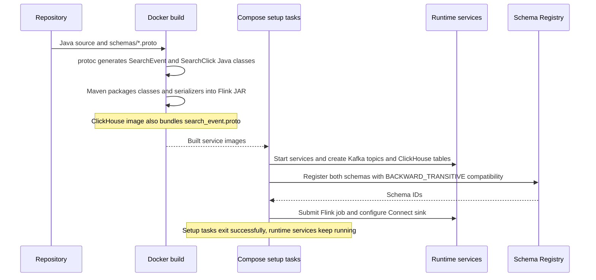
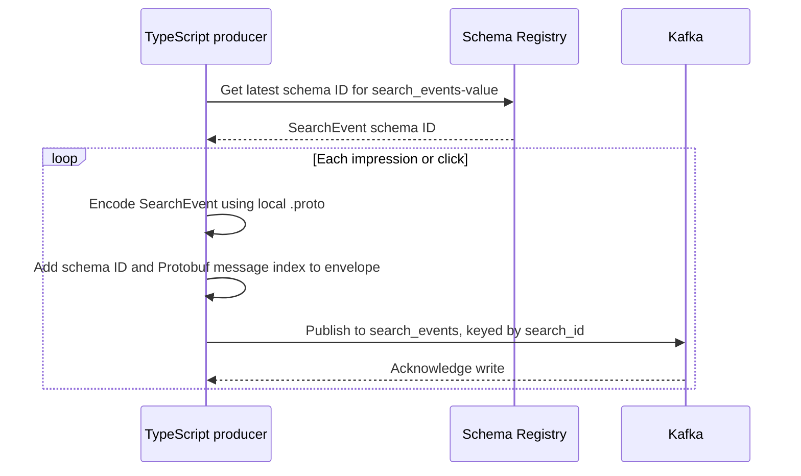
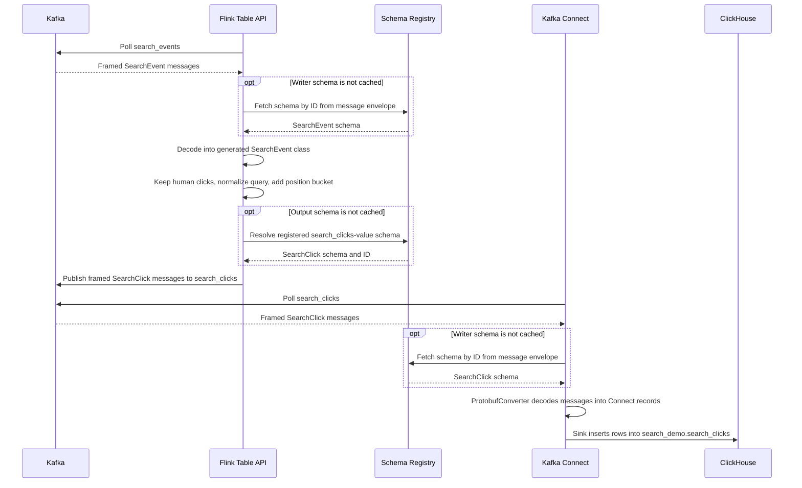
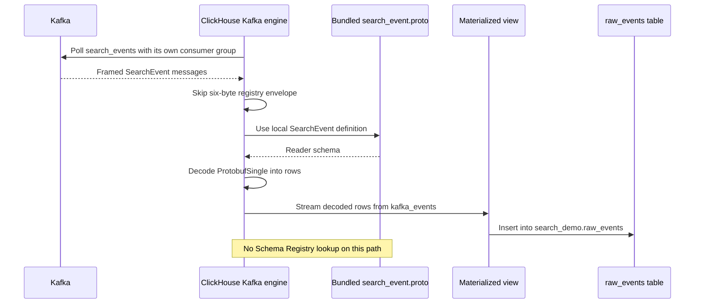

# ClickHouse playground

[](https://github.com/hatutah/clickhouse-playground/actions/workflows/ci.yml)

A small, local Docker Compose setup for exploring Kafka, registry-backed Protobuf, Flink's Java Table API, and two ways to ingest events into ClickHouse. No cloud accounts, ZooKeeper, or host language runtime required.

Both paths consume the same input independently. `raw_events` contains impressions and clicks, including bots. `search_clicks` contains the human clicks selected and enriched by Flink.

Schema Registry stores the message contracts; Kafka carries the event bytes. During the Docker build, `protoc` turns the `.proto` files into Java classes bundled with the Flink job. At runtime, Flink and Connect resolve schema metadata through the registry. The ClickHouse Kafka engine uses its bundled `.proto` file.

## Start and verify

Install Docker with Compose v2 or newer. Allow roughly 6 GB of available Docker memory, plus disk space for images. Ports 9092, 8123, 9000, 8081, 8082, and 8083 must be free. The images support Intel and Apple Silicon; no architecture override is needed.

```sh
docker compose up --build -d
docker compose run --rm smoke
```

The first start downloads images, the Flink Kafka table connector, the official ClickHouse sink plugin, and Confluent's Protobuf converter. Docker builds the Java job and generated Protobuf classes using pinned Maven 3.9.9, Java 17, and protoc 3.25.5. Startup creates the topics and database tables, registers the `.proto` schemas, submits the streaming Table API job, and registers the sink through Connect's REST API.

**1. Build and startup**



ClickHouse is pinned to 26.3.2.3 for its `kafka_schema_registry_skip_bytes` support.

The smoke test checks that both registered schemas are Protobuf and that an incompatible field-type change fails the registry compatibility check. It then waits for the job and sink task, produces a batch with a unique `run_id`, and checks both ClickHouse paths. Expected output:

```text
PASS run_id=...: 20 raw events via Kafka engine; 8 human clicks via Flink + Connect.
```

Generate more traffic (20 searches, each with an impression and a click):

```sh
docker compose run --rm producer
COUNT=100 INTERVAL_MS=50 docker compose run --rm producer
```

`COUNT` is the number of searches; `INTERVAL_MS` is the delay between individual events. Each run prints its ID and expected row counts. The producer exits after the batch, while the pipeline keeps running.

## Explore the data

Run the included analytics queries:

```sh
docker compose exec -T clickhouse clickhouse-client \
  --user demo --password demo --multiquery < clickhouse/queries.sql
```

Or open a SQL prompt:

```sh
docker compose exec clickhouse clickhouse-client --user demo --password demo --database search_demo
```

```sql
SELECT * FROM raw_events ORDER BY event_time_ms DESC LIMIT 5;
SELECT * FROM search_clicks ORDER BY event_time_ms DESC LIMIT 5;
SELECT fromUnixTimestamp64Milli(toInt64(event_time_ms)) AS event_time,
       query_normalized, result_position, position_bucket
FROM search_clicks LIMIT 10;
```

Inspect Kafka topic metadata:

```sh
docker compose exec kafka /opt/kafka/bin/kafka-topics.sh \
  --bootstrap-server kafka:29092 --describe --topic search_clicks
```

| Service | Local address | Notes |
| --- | --- | --- |
| Flink UI | http://localhost:8081 | Job graph, records, checkpoints, exceptions |
| ClickHouse HTTP | http://localhost:8123 | User `demo`, password `demo` |
| ClickHouse SQL UI | http://localhost:8123/play | Enter the same credentials |
| Kafka Connect REST | http://localhost:8083 | Connector configuration and task status |
| Schema Registry REST | http://localhost:8082 | Protobuf subjects, versions, and compatibility |
| Kafka | `localhost:9092` | Host applications use this address |
| ClickHouse native | `localhost:9000` | SQL clients such as DataGrip |

```sh
curl -s localhost:8083/connectors/search-clicks-sink/status
curl -u demo:demo 'http://localhost:8123/?query=SELECT%20count()%20FROM%20search_demo.search_clicks'
curl -s localhost:8082/subjects
curl -s localhost:8082/subjects/search_events-value/versions/latest
curl -s localhost:8082/subjects/search_clicks-value/versions/latest
```

Containers use `kafka:29092`; host clients use `localhost:9092`. Published ports bind to loopback. Credentials and plaintext transport are for local development only.

## What the examples demonstrate

**Events:** [src/events.ts](src/events.ts) simulates a web application recording `search_impression` and `result_click`. The shared `search_id` links a click to its impression; it is also the Kafka message key. `session_id`, `user_id`, result ID, result position, and epoch milliseconds provide useful analytics dimensions. Every fifth search is a bot. All searches deliberately have one click, so the sample human click-through rate is 1.0; this is a deterministic teaching fixture, not a realistic conversion model.

**2. Produce events**



An example decoded click message (Kafka stores Protobuf binary, not JSON):

```json
{
  "event_id": "9a4e17c8-f301-4b9d-98f8-8b1311e7b111",
  "run_id": "c5e34319-1afb-44b3-b35e-fd936e9a2111",
  "event_type": "result_click",
  "event_time_ms": 1792670400250,
  "search_id": "7f38fa48-f906-4afd-a353-eebfc18c5111",
  "session_id": "adf84181-5414-4bba-8ac9-4df43c434111",
  "user_id": "user-1",
  "query_text": "  ClickHouse  ",
  "result_id": "product-1",
  "result_position": 2,
  "is_bot": 0
}
```

**Flink topic-to-topic transformation:** [SearchClickJob.java](flink/src/main/java/demo/SearchClickJob.java) reads `search_events`, keeps human clicks with valid positions, trims and lowercases the query, and adds `position_bucket` (`top_3` or `below_3`). It writes registry-framed Protobuf to `search_clicks`. The Java Table API defines Kafka byte tables with `Schema` and `TableDescriptor`. [ProtoFunctions.java](flink/src/main/java/demo/ProtoFunctions.java) uses Confluent's Protobuf deserializer and serializer to convert between bytes and table fields. The transformation itself uses fluent `filter` and `select` expressions. These table declarations do not store data inside Flink. Checkpointing runs every 10 seconds.

```java
tables.from("search_events")
    .select(call(ProtoFunctions.DecodeEvent.class, $("payload")).as("event"))
    .select($("event").flatten())
    .as(/* decoded field names */)
    .filter($("event_type").isEqual("result_click")
        .and($("is_bot").isEqual(0))
        .and($("result_position").isGreater(0)))
    .select(/* output fields and transformation expressions */)
    .executeInsert("search_clicks");
```

The job JAR bundles generated Protobuf classes and Confluent serialization dependencies; Flink provides its API and runtime. The Kafka connector JAR retains `sql` in its upstream artifact name because SQL and the Table API share the same table connector. Flink 1.20's built-in `protobuf` table format does not understand Confluent's wire envelope, hence the boundary functions.

**Kafka Connect sink:** [connect/clickhouse-sink.json](connect/clickhouse-sink.json) configures ClickHouse's official sink to consume `search_clicks` and insert into the same-named ClickHouse table. The table is created explicitly before registration. The connector uses Confluent's `ProtobufConverter` with Schema Registry and a string key converter. Connector configuration, task status, and committed offsets live in Kafka internal topics. Registration uses an idempotent REST `PUT`.

**3. Transform with Flink and ingest through Kafka Connect**



**ClickHouse Kafka engine:** [clickhouse/init.sql](clickhouse/init.sql) defines `kafka_events` as a consumer of `search_events`. A materialized view continuously inserts records into the persistent `raw_events` MergeTree table. Query `raw_events`, since the Kafka engine table is a streaming consumer rather than stored history. ClickHouse uses the bundled `search_event.proto` with `ProtobufSingle`, skipping the six-byte Confluent header. It does **not** look up the schema ID in Registry. This example fixes one top-level message per file, so the message-index encoding is a single zero byte. Changing that layout requires revisiting the skip setting. ClickHouse and Flink use different consumer groups, so both receive every input event independently.

**4. Ingest directly through the ClickHouse Kafka engine**

This path runs independently of Flink and Kafka Connect and stores all source events, including impressions and bots.



**Schema Registry:** [schemas/search_event.proto](schemas/search_event.proto) and [schemas/search_click.proto](schemas/search_click.proto) define the message contracts. Startup registers them under `search_events-value` and `search_clicks-value` with `BACKWARD_TRANSITIVE` compatibility. Schema versions are persisted in Kafka's `_schemas` topic, using the existing Kafka volume. Each message value carries a magic byte, a four-byte schema ID, a message index, and the Protobuf payload. Keys remain plain strings. The registry checks schema evolution; this Apache Kafka broker does not reject arbitrary bytes from other producers. Keep field numbers stable and reserve deleted field numbers when evolving Protobuf schemas.

## Change and rerun

- Producer or TypeScript changes: `docker compose build producer connector smoke`.
- Connector settings: edit the JSON, rebuild the app image, then run `docker compose run --rm connector`.
- Flink Java changes: run the commands below to rebuild the job and recreate its services. Kafka and ClickHouse data are preserved. Submission skips while a job is already running.
- Protobuf schema changes: edit `schemas/*.proto`, then run `docker compose up --build -d` to rebuild the producer tools, generated Java classes, and ClickHouse's bundled reader schema and register the schemas. Incompatible schema changes stop the registration service.
- ClickHouse schema changes: initialization SQL runs only on an empty ClickHouse data directory. Apply an explicit `ALTER` in the SQL prompt or reset the playground below.

```sh
docker compose build jobmanager
docker compose up -d --no-deps --force-recreate jobmanager taskmanager flink-submit
docker compose run --rm smoke
```

Inspect service state and logs:

```sh
docker compose ps -a
docker compose logs --tail=100 connector flink-submit
docker compose logs -f connect jobmanager taskmanager clickhouse
```

`topics`, `schemas`, `connector`, and `flink-submit` exiting successfully is expected. A submitted Flink job can fail after the submission process exits; check its UI and use the smoke test to verify actual delivery. A failed Connect task exposes its error in the REST status response above.

Stop the stack while preserving Kafka and ClickHouse data:

```sh
docker compose down
```

Delete this playground's stored events and offsets, then start clean (destructive to playground data):

```sh
docker compose down -v
docker compose up --build -d
```

This is a single-broker, at-least-once development example. Retries or restarts can produce duplicate rows; `event_id` allows you to identify them. The sink deliberately has `exactlyOnce=false`, so ClickHouse Keeper is unnecessary. Flink checkpoints use container-local storage without JobManager high availability; recreating the cluster does not restore a checkpoint automatically. A new job resumes from Kafka committed group offsets, which can replay records since the last committed checkpoint. The smoke test checks an isolated fresh batch during normal operation, not recovery guarantees.

## Optional host development

Docker is sufficient for the walkthrough. For editing and running the TypeScript tools on the host, use the installed asdf tools pinned in [.tool-versions](.tool-versions):

```sh
asdf install
pnpm install --frozen-lockfile
pnpm run typecheck
pnpm run build
pnpm run produce
pnpm run smoke
```

Host commands default to the published localhost endpoints. `KAFKA_BROKERS`, `CLICKHOUSE_URL`, `CONNECT_URL`, `FLINK_URL`, and `SCHEMA_REGISTRY_URL` override these endpoints when needed. The Flink job reads `KAFKA_BROKERS` and `SCHEMA_REGISTRY_URL` the same way; [compose.yaml](compose.yaml) sets them for the Flink containers.

Upstream references: [Flink Table API](https://nightlies.apache.org/flink/flink-docs-release-1.20/docs/dev/table/tableApi/), [Flink Kafka table connector](https://nightlies.apache.org/flink/flink-docs-release-1.20/docs/connectors/table/kafka/), [ClickHouse Kafka Connect sink](https://clickhouse.com/docs/integrations/kafka/clickhouse-kafka-connect-sink), and [ClickHouse Kafka engine](https://clickhouse.com/docs/engines/table-engines/integrations/kafka).

## License

This project is released under the [MIT License](LICENSE).

The stack downloads third-party software at build and run time; each keeps its own license. Apache Kafka, Apache Flink, and the ClickHouse server and Kafka Connect sink are Apache 2.0. Confluent Schema Registry (`confluentinc/cp-schema-registry`) is under the [Confluent Community License](https://www.confluent.io/confluent-community-license/), which permits this kind of local use but is not an OSI-approved open source license. Confluent's Protobuf serializer and converter libraries list both that license and Apache 2.0. Build downloads are pinned and verified with SHA-256 checksums.
